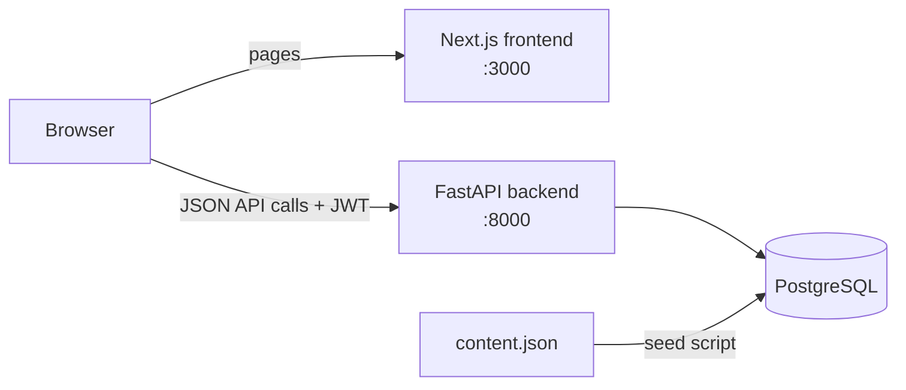
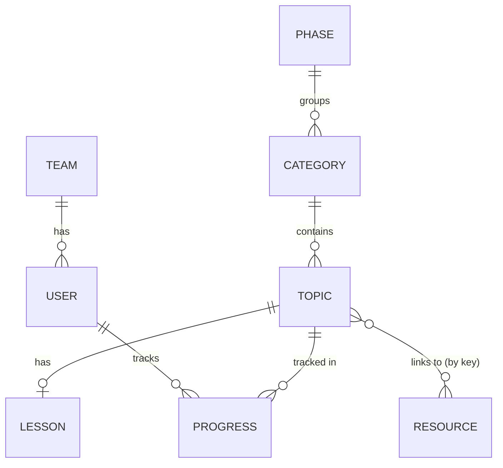

# Architecture

## Overview

The frontend is a set of client-rendered pages. The browser calls the backend API directly with a bearer token (JWT) stored after login. The backend enforces all permissions; the frontend only hides what a role can't use.

## Data model

| Table | Purpose |
|---|---|
| teams | Groups of users; managers see their own team |
| users | Accounts with role (admin / manager / learner), hours-per-week setting |
| phases, categories | The learning-path structure |
| topics | One learning item: metadata, explanation, key points, exercises |
| lessons | Full study material for a topic, stored as JSON (sections, quiz, links) |
| resources | Verified external links, referenced by key |
| progress | One row per user per topic: status, confidence, key points ticked, notes |

## API

All endpoints are under `/api` and documented interactively at `/docs`.

| Area | Endpoints |
|---|---|
| Auth | `POST /auth/login`, `GET/PATCH /auth/me`, `POST /auth/change-password` |
| Catalog | `GET /catalog`, `GET /topics/{id}`, `GET /resources` |
| Content (admin) | `POST /topics`, `PUT /topics/{id}`, `DELETE /topics/{id}`, `PUT /topics/{id}/lesson` |
| Progress | `GET /progress/me`, `PUT /progress/me/{topic_id}` |
| Users & teams | `GET/POST /users`, `PATCH /users/{id}` (admin); `GET /teams`, `POST /teams`, `GET /teams/{id}/progress` (manager/admin) |

## Key decisions

- **Separate frontend and backend** so each can scale and deploy independently, and so the API can later serve a mobile app or AI agents.
- **Python backend** because the planned AI features (tutor, retrieval over lessons) have the best library support in Python.
- **Lessons as JSON** so content can be edited in the admin screen or in bulk without schema changes for every new lesson format.
- **Seed is idempotent**: content upserts by id; user progress is never modified by a content reload.
- **Tests run on SQLite**, while CI also runs migrations and the seed against real PostgreSQL.

## Scaling path

1. Deploy: frontend to Vercel, backend to Render/Railway/Fly, database to Neon/Supabase.
2. Add caching for `/catalog` (it changes rarely).
3. Move JWT storage to httpOnly cookies when frontend and API share a domain.
4. Add SSO (OIDC) for company logins.
5. Add pgvector and an AI tutor endpoint that answers from lesson content with citations.
